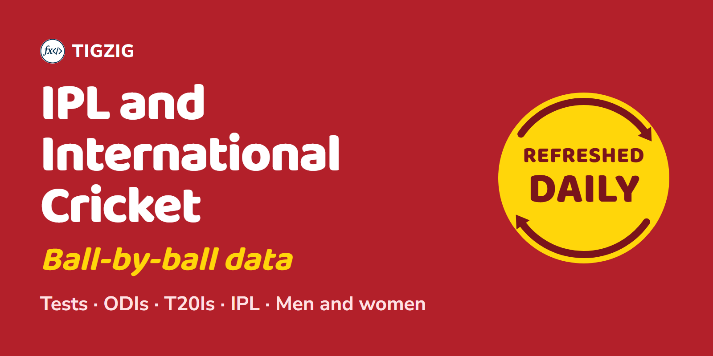

# CRICKET

Ball-by-ball cricket from Cricsheet: Tests, ODIs, T20s and the IPL, men's and women's, with match info and a player registry.

Source: Cricsheet (cricsheet.org).

Browse on tigzig.com: https://www.tigzig.com/downloads#app-cricket · JSON for this group: https://api.tigzig.com/downloads/cricket

Documentation:

- For people: https://www.tigzig.com/apis/database
- For AI agents: https://db-mcp.tigzig.com/openapi.json
- Query the same cricket data with SQL on Postgres or DuckDB, no download needed: [tigzig.com/apis/database](https://www.tigzig.com/apis/database).
- Column descriptions: [cricket_columns.csv](../dictionaries/cricket_columns.csv), one row per column, marked as Cricsheet's definition or ours. Cricsheet's own notes go further: the [CSV format notes](https://cricsheet.org/format/csv_ashwin/) and the [player register](https://cricsheet.org/register/).
- Guides: [14 things that trip people up](https://www.tigzig.com/post/cricket-database-14-things-that-trip-people-up-sep2026), [how to identify one delivery](https://www.tigzig.com/agents-faq/how-do-i-identify-one-delivery-in-ball-by-ball-cricket-data) and [worked SQL queries](https://www.tigzig.com/post/db-mcp-cricket-sql-queries-aug2026).

| Dataset | What it holds | Updated | Files |
|---|---|---|---|
| **Every delivery, all formats** [Docs](https://www.tigzig.com/apis/database) | One row per ball across Test, ODI and T20 internationals, men's and women's, plus the IPL. Filter on the gender and team_type columns. | twice daily | [CSV.gz](https://api.tigzig.com/cricket/v1/download/ball_by_ball.csv.gz) · [Parquet](https://api.tigzig.com/cricket/v1/download/ball_by_ball.parquet) |
| **Match players** [Docs](https://www.tigzig.com/apis/database) | Who played in each match, one row per player per match. | twice daily | [CSV](https://api.tigzig.com/cricket/v1/download/match_players.csv) · [CSV.gz](https://api.tigzig.com/cricket/v1/download/match_players.csv.gz) · [Parquet](https://api.tigzig.com/cricket/v1/download/match_players.parquet) |
| **Matches** [Docs](https://www.tigzig.com/apis/database) | One row per match across every format: teams, venue, date, toss and result. | twice daily | [CSV](https://api.tigzig.com/cricket/v1/download/match_info.csv) · [CSV.gz](https://api.tigzig.com/cricket/v1/download/match_info.csv.gz) · [Parquet](https://api.tigzig.com/cricket/v1/download/match_info.parquet) |
| **Player register** [Docs](https://www.tigzig.com/apis/database) | One row per person, with the identifiers used across the other tables. | twice daily | [CSV](https://api.tigzig.com/cricket/v1/download/people.csv) · [CSV.gz](https://api.tigzig.com/cricket/v1/download/people.csv.gz) · [Parquet](https://api.tigzig.com/cricket/v1/download/people.parquet) |
| **Deliveries: IPL** [Docs](https://www.tigzig.com/apis/database) | A slice of ball_by_ball: IPL only. | twice daily | [CSV.gz](https://api.tigzig.com/cricket/v1/download/ball_by_ball_ipl.csv.gz) · [Parquet](https://api.tigzig.com/cricket/v1/download/ball_by_ball_ipl.parquet) |
| **Deliveries: ODI, men** [Docs](https://www.tigzig.com/apis/database) | A slice of ball_by_ball: ODI, men only. | twice daily | [CSV.gz](https://api.tigzig.com/cricket/v1/download/ball_by_ball_odi_men.csv.gz) · [Parquet](https://api.tigzig.com/cricket/v1/download/ball_by_ball_odi_men.parquet) |
| **Deliveries: ODI, women** [Docs](https://www.tigzig.com/apis/database) | A slice of ball_by_ball: ODI, women only. | twice daily | [CSV.gz](https://api.tigzig.com/cricket/v1/download/ball_by_ball_odi_women.csv.gz) · [Parquet](https://api.tigzig.com/cricket/v1/download/ball_by_ball_odi_women.parquet) |
| **Deliveries: T20 internationals, men** [Docs](https://www.tigzig.com/apis/database) | A slice of ball_by_ball: T20 internationals, men only. | twice daily | [CSV.gz](https://api.tigzig.com/cricket/v1/download/ball_by_ball_t20_men.csv.gz) · [Parquet](https://api.tigzig.com/cricket/v1/download/ball_by_ball_t20_men.parquet) |
| **Deliveries: T20 internationals, women** [Docs](https://www.tigzig.com/apis/database) | A slice of ball_by_ball: T20 internationals, women only. | twice daily | [CSV.gz](https://api.tigzig.com/cricket/v1/download/ball_by_ball_t20_women.csv.gz) · [Parquet](https://api.tigzig.com/cricket/v1/download/ball_by_ball_t20_women.parquet) |
| **Deliveries: Test, men** [Docs](https://www.tigzig.com/apis/database) | A slice of ball_by_ball: Test, men only. | twice daily | [CSV.gz](https://api.tigzig.com/cricket/v1/download/ball_by_ball_test_men.csv.gz) · [Parquet](https://api.tigzig.com/cricket/v1/download/ball_by_ball_test_men.parquet) |
| **Deliveries: Test, women** [Docs](https://www.tigzig.com/apis/database) | A slice of ball_by_ball: Test, women only. | twice daily | [CSV.gz](https://api.tigzig.com/cricket/v1/download/ball_by_ball_test_women.csv.gz) · [Parquet](https://api.tigzig.com/cricket/v1/download/ball_by_ball_test_women.parquet) |
| **All cricket tables in one database file** [Docs](https://www.tigzig.com/apis/database) | Every table above in a single file. Open it locally and every table is already loaded. | twice daily | [DuckDB.gz](https://api.tigzig.com/cricket/v1/download/cricket_all_tables.duckdb.gz) · [SQLite.gz](https://api.tigzig.com/cricket/v1/download/cricket_all_tables.sqlite.gz) |

Licence: ODC-BY 1.0. Match data from Cricsheet (cricsheet.org). TigZig is not affiliated with or endorsed by Cricsheet.
Terms: https://api.tigzig.com/cricket/v1/terms
Provided as is, with no guarantee of accuracy, completeness or availability.

[All groups](../README.md)
